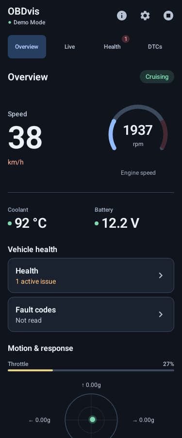
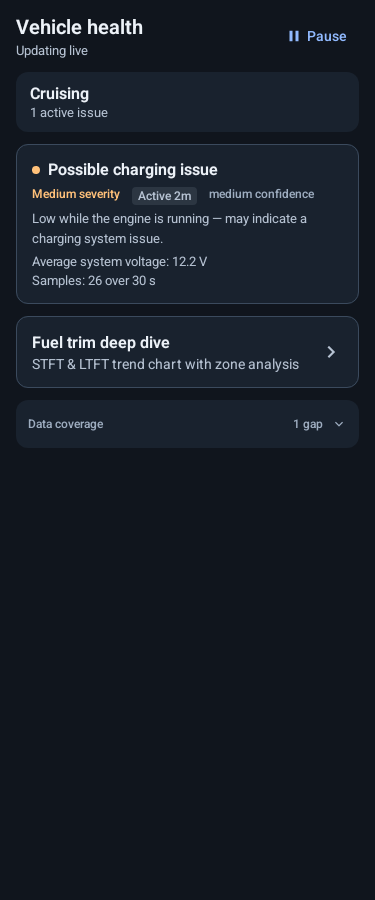
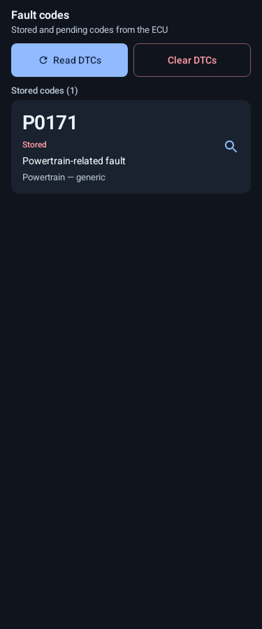
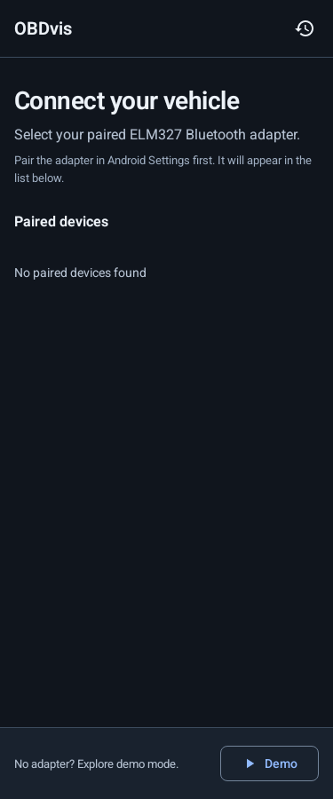
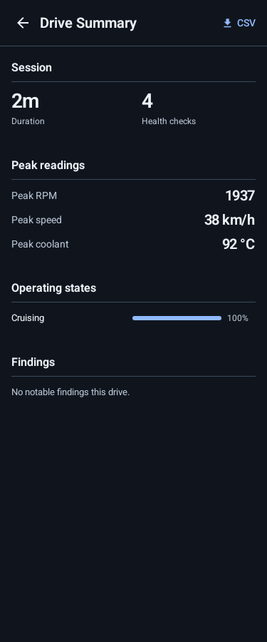
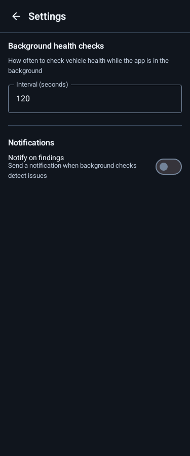

<!-- Hallmark · pre-emit critique: P5 H4 E4 S5 R5 V4 -->
# OBDvis UI redesign · 0.1.13

Implemented the approved dark instrument-panel system in Jetpack Compose. These are actual native renders using labeled design fixtures, not live vehicle readings or browser mockups.

| Overview | Health | Fault codes |
| --- | --- | --- |
|  |  |  |

| Connection | Drive summary | Settings |
| --- | --- | --- |
|  |  |  |

[Large-text Health preview](health-large-text.png) · [Landscape Overview](overview-landscape.png)

## What changed

- A shared dark palette, readable secondary text, tabular numeric styles, spacing, shapes, and headers.
- Speed leads Overview; RPM uses a compact arc. Coolant, voltage, and health shortcuts precede secondary motion instruments. Missing speed/RPM readings display an em dash.
- Dashboard navigation retains four destinations and gains larger touch targets and explicit count badges.
- Health findings separate title, severity, lifecycle, confidence, description, and evidence. Removed decorative entrance/expansion animations; retained active/fading behavior.
- Setup has a scrollable device list, a measured footer, explicit error state, and a modal connecting state. Screen state and Bluetooth callbacks stay with the existing ViewModel.
- Live sensor rows expose checkbox semantics and use larger targets; chart labels and empty states are clearer. The portrait sensor panel is capped at 260 dp; landscape width is 240 dp.
- Reports, history, settings, About, and licenses share the system. Reports now receive the app theme when opened directly.
- DTC clearing and saved-drive deletion still require confirmation. Polling, diagnostic rules, data storage, exports, and Android Auto logic were not changed.

## Validation · 2026-09-30

- Debug APK assembled successfully: `android/app/build/outputs/apk/debug/app-debug.apk`.
- Existing unit suite: **164 passed**, zero failures, errors, or skipped tests.
- Native screenshot harness: **78 renders passed** (13 screens/states across 6 configurations).
- Configurations: 320×900, 375×900, 414×900, 768×1024, 320×1100 at 1.5× font scale, and 768×375 in landscape. Dimensions are dp at mdpi.
- Representative renders inspected for hierarchy, long text, missing readings, connection errors, and landscape layout. Fixed an RPM aspect-ratio overflow found during review.
- Android lint: **zero errors**, six existing warnings: three public `Modifier` parameter-order warnings, a manifest API-level attribute, a private resource, and the exported Car App service. Existing public signatures were preserved.
- `git diff --check` passes.

Calculated sRGB contrast for opaque text/background tokens:

| Pair | Contrast |
| --- | --- |
| Primary text / background | 16.27:1 |
| Secondary text / surface | 8.89:1 |
| Muted text / raised surface | 5.94:1 |
| Blue action text / surface | 8.15:1 |
| Dark text / blue button | 8.00:1 |
| Error text / error surface | 6.55:1 |

The renderer checks layout, not real Bluetooth behavior. No connected Android device or configured emulator was available. On-device checks remain for permission dialogs, pairing/connection, live chart gestures, export/document picker, destructive confirmation interactions, TalkBack/focus, and system insets. Snapshot completion does not certify those interactions.

## Reproducing checks

Run from `android/` with a full JDK (the default Java installation in this workspace lacked `jlink`):

```sh
bash gradlew -Dorg.gradle.java.home=/home/zes/.jdks/jbr-21.0.11 \
  :app:assembleDebug :app:testDebugUnitTest :app:lintDebug --offline
```

Compose fixtures live in `android/app/src/debug/java/com/obdvis/android/ui/RedesignPreviews.kt` and can be opened in Android Studio. They are excluded from release builds.

The optional [Paparazzi harness](RedesignRenderTest.kt) ran in a temporary copy of `android/`. To repeat it, add `id("app.cash.paparazzi") version "1.3.5"` to that copy's app plugins, place the harness in `app/src/test/java/com/obdvis/android/ui/`, then run:

```sh
bash gradlew :app:recordPaparazziDebug --tests '*RedesignRenderTest'
```

Paparazzi and its rendering dependencies were not added to the production Gradle configuration.

## Hallmark review

Structure: instrument workbench, grouped setup lists, and drive reports. Theme: the approved OBDvis dark palette. Enrichment: none. Motion: native control feedback; no decorative reveals. One consistent system across the app; structural variety follows each screen's purpose.

Native adaptations are recorded in `design.md`: Android typography instead of web fonts, Kotlin runtime tokens instead of CSS, dp/sp widths, and native semantics/control states. Large-text navigation may scroll horizontally to keep labels legible. The web-only gates are not claimed as a 58/58 pass. Device accessibility and runtime interaction checks remain open as listed above.
